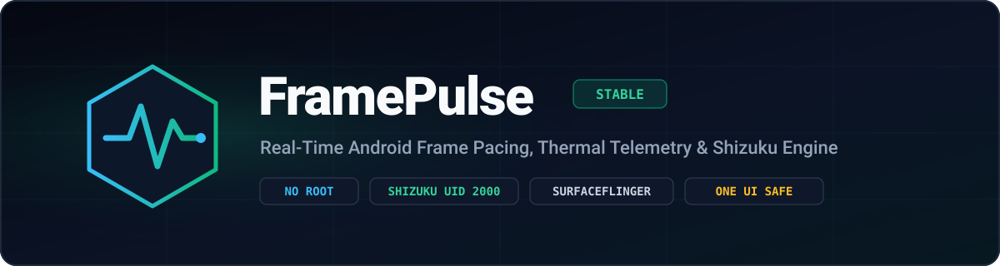
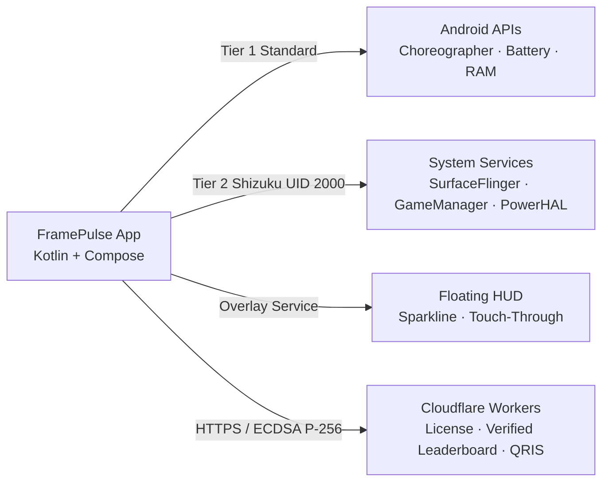

  

  
  
  
  
  

  <a href="https://github.com/hinaaaq/FramePulse/releases/latest"><strong>⬇ Download APK v1.0.0 Stable</strong></a>
  &nbsp;·&nbsp;
  <a href="#device-capabilities">Capabilities</a>
  &nbsp;·&nbsp;
  <a href="#cara-pasang--upgrade">Cara Pasang</a>
  &nbsp;·&nbsp;
  <a href="SECURITY.md">Keamanan &amp; VirusTotal</a>
  &nbsp;·&nbsp;
  <a href="CHANGELOG.md">Changelog</a>

---

## Ringkasan

**FramePulse** adalah utilitas telemetri performa dan *floating HUD* untuk Android yang dibangun dengan **Kotlin**, **Jetpack Compose**, dan **Shizuku (`UID 2000`)** — tanpa memerlukan akses root.

Berbeda dari aplikasi *game booster* yang penuh klaim palsu (*placebo*), iklan, atau memaksa `am kill-all`, FramePulse hanya mengeksekusi API sistem Android yang nyata dan menampilkan status kemampuan perangkat secara transparan.

### Keunggulan Utama
- **Capability Engine Transparan:** Menampilkan status kemampuan perangkat secara langsung (`Android API ✓`, `Shizuku ✓`, `SurfaceFlinger ✓`, `Game Mode ✓`).
- **Update Tanpa Uninstall:** Semua rilis resmi ditandatangani dengan *release keystore* permanen. Saat ada versi baru, cukup install langsung menimpa versi lama — pengaturan HUD, tema, lisensi, dan riwayat benchmark tetap aman.
- **Verifikasi Integritas Terbuka:** Setiap rilis disertai **SHA-256 Checksum** (`SHA256SUMS.txt`) dan tautan cek **VirusTotal** langsung dari pipeline GitHub Actions.
- **Verified Benchmark & Leaderboard:** Input manual FPS/suhu dikunci total; skor global diambil otomatis dari hasil *Session Benchmark Recorder* asli (minimal 15 detik) dengan validasi integritas di server.

---

## Device Capabilities

FramePulse menyesuaikan fitur secara otomatis sesuai izin yang aktif di perangkat:

| Kemampuan & Fitur | Tier 1 — Standard | Tier 2 — Shizuku (`UID 2000`) |
| :--- | :---: | :---: |
| Floating HUD Overlay + 4 Gaya Visual (*Glass, Pill, Deck, Minimal*) | ✓ | ✓ |
| Frame Pacing via Android Choreographer | ✓ | ✓ |
| Suhu Baterai, Daya (Watt/mA), RAM & Network I/O | ✓ | ✓ |
| Quick Settings Tile, Touch-Through Lock & Snap-to-Edge | ✓ | ✓ |
| **SurfaceFlinger** Frame Timing & 1% Low | — | ✓ |
| **Android Game Mode** & Preset Per-Game (Downscale + Target FPS) | — | ✓ |
| **Power HAL** Fixed Performance + Auto-Thermal Guard | — | ✓ |
| **ART Compiler** (`speed-profile` per-paket) | — | ✓ |

---

## Arsitektur Sistem

---

## Cara Pasang & Upgrade

1. Buka halaman [**GitHub Releases**](https://github.com/hinaaaq/FramePulse/releases/latest) dan unduh **`FramePulse-v1.0.0-signed.apk`**.
2. Pasang APK seperti biasa, lalu aktifkan izin **Floating Overlay** di tab **Setup**.
3. *(Opsional — direkomendasikan)* Pasang dan jalankan [**Shizuku**](https://shizuku.rikka.app/), lalu hubungkan di tab **Setup** untuk mengaktifkan telemetri Tier 2.

> **Upgrade Tanpa Kehilangan Data:** Mulai dari `v1.0.0`, semua rilis resmi memakai tanda tangan digital permanen. Untuk update ke versi berikutnya, cukup unduh dan install langsung tanpa uninstall.

---

## Pertanyaan Umum (FAQ)

<strong>Apakah FramePulse membutuhkan Root?</strong>

 
Tidak. FramePulse berjalan 100% tanpa root. Fitur lanjutan (SurfaceFlinger, Game Mode, Power HAL) menggunakan jembatan resmi <a href="https://shizuku.rikka.app/">Shizuku</a> dengan hak akses ADB Shell (<code>UID 2000</code>).

<strong>Apakah aman untuk Samsung One UI / Stock Android?</strong>

 
Aman. FramePulse tidak menjalankan <code>am kill-all</code>, tidak memodifikasi partisi sistem, dan menyertakan <strong>Auto-Thermal Guard</strong> yang otomatis menonaktifkan Fixed Performance HAL jika suhu mencapai batas aman (41°C / 43°C / 45°C).

<strong>Bagaimana cara memastikan file APK asli dan bebas virus?</strong>

 
APK dibangun langsung oleh <strong>GitHub Actions</strong> dari source code di repositori ini. Kamu dapat mencocokkan hash <code>SHA-256</code> di file <code>SHA256SUMS.txt</code> dan memeriksa hasil pemindaian langsung lewat tautan <strong>VirusTotal</strong> di setiap halaman rilis.

---

## Lisensi

Hak Cipta © 2026 **Shin ([@hinaaaq](https://github.com/hinaaaq))**. Lihat file [LICENSE](LICENSE) untuk detail lisensi dan [SECURITY.md](SECURITY.md) untuk kebijakan keamanan.
